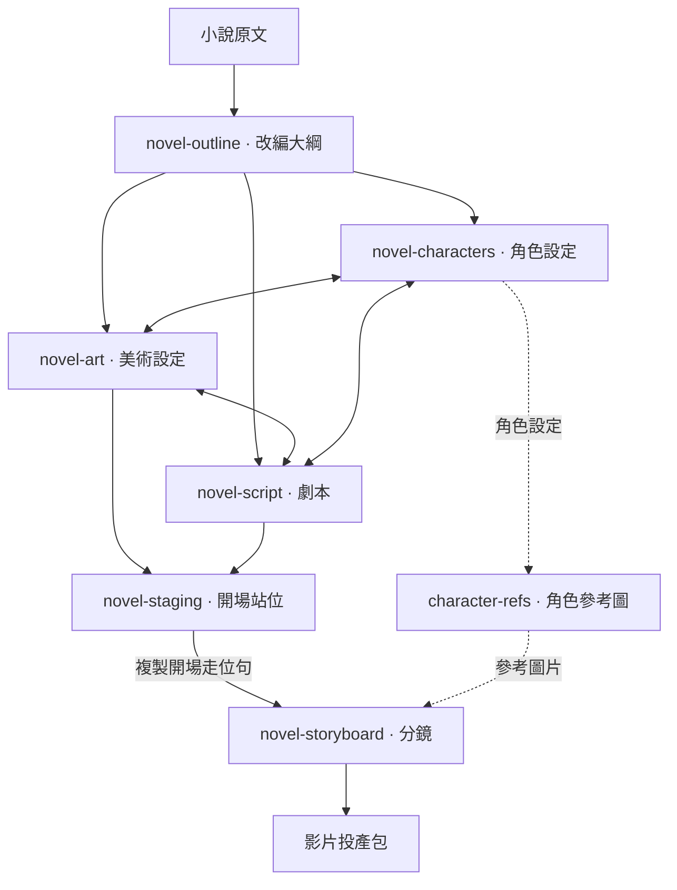
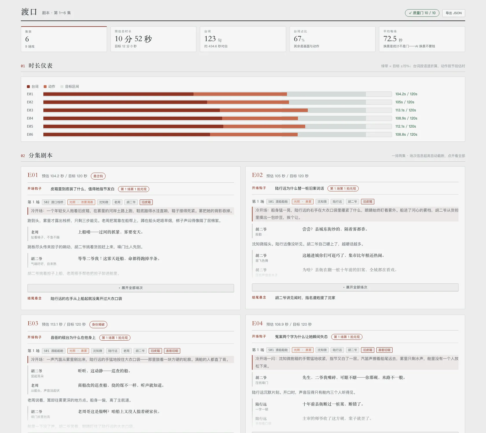
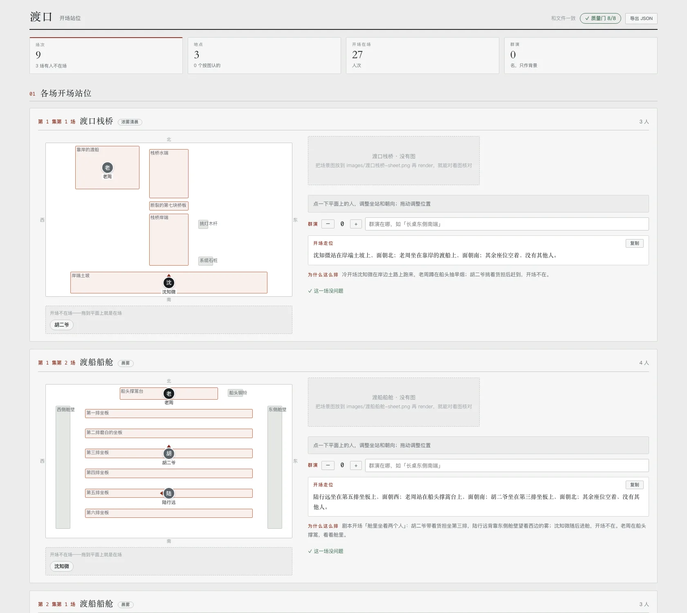
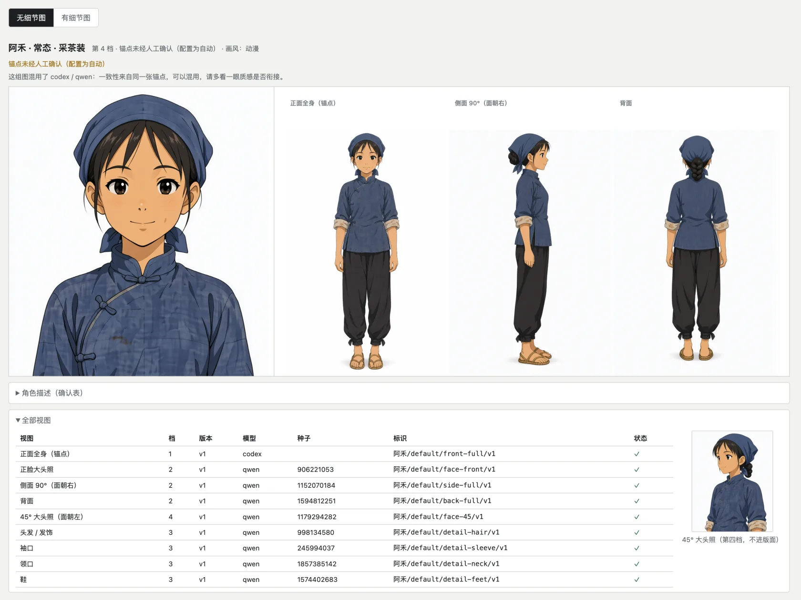

<div align="center">

# shuohao-skills

**面向各類 Agent 的 AI 短劇製作 skill 集合**

[English](README.en.md) | 中文 | [X @eternityspring](https://x.com/eternityspring)

**[Skill 一覽](#skill-一覽) · [安裝](#安裝) · [前置條件](#前置條件) · [儲存庫約定](#儲存庫約定)**

</div>

## ❤️ 贊助商

> [想出現在這裡？](mailto:eternityspring@gmail.com)

<details open>
<summary>點選摺疊</summary>

<table>
<tr>
<td width="180"><a href="https://go.apimart.ai/tw-shuohao-skills"></a></td>
<td>感謝 <a href="https://go.apimart.ai/tw-shuohao-skills">APIMart</a> 贊助了本專案！APIMart 是專注 AI 圖片/影片生成的低價 API 平臺，GPT-Image-2 低至 $0.006/張，1 美元可生圖 160+ 張。圖片、影片一套非同步 API 通吃，提交任務拿 ID、回呼取結果，跑批萬張不超時、換模型不改程式碼。按量付費、無月費，透過<a href="https://go.apimart.ai/tw-shuohao-skills">此註冊連結</a>註冊即可開用。</td>
</tr>
<tr>
<td width="180"><a href="https://studio.reelbenchai.com"></a></td>
<td><a href="https://studio.reelbenchai.com">Reelbench Studio</a> 是本 skill 專案作者開發的付費 AI 影視工作臺，交付的是能離線執行的原始碼。本地 Codex 負責理解、拆解與編排，自部署 ComfyUI 負責影像與影片生成，素材和專案都留在你自己的裝置裡。</td>
</tr>
<tr>
<td width="180"></td>
<td>「賽博班底」是本 skill 專案作者做的微信小程式，收集 AI 短影片用得上的角色、服裝、表情等參考圖，按類別和標籤交叉篩選。每張參考圖都配中文提示詞，一鍵複製；點開大圖長按就能儲存。微信掃左邊的小程式 QR 碼就能開啟。</td>
</tr>
</table>

</details>

## Skill 一覽

**面向各類 Agent 的 AI 短劇製作 skill 集合**：從一本小說到直接交給生成管線的製作素材——排大綱、拆角色、出場景與道具設定、寫劇本、排開場站位、切分鏡。每個 skill 都是自包含目錄，任何能夠讀取 `SKILL.md` 並執行隨附腳本的 Agent 都可以使用；Claude Code 和 Codex 只是其中兩個執行示例，並非使用前提。

儲存庫目前有 **8 個 skill：6 個製作階段、可獨立使用的角色參考圖生成，以及 fork 專屬的維運 skill `upstream-sync`**。改編大綱收斂結構，角色、美術、劇本同步迭代；開場站位在分鏡之前確定每場人物的位置。



> **這是 fork。** 上游是 [eternityspring/shuohao-skills](https://github.com/eternityspring/shuohao-skills)，
> 並在原專案基礎上持續整合新功能。本 fork 的差異：
>
> - **預設輸出台灣正體中文**（`zh-TW`），用詞照台灣習慣而不只是換字形。要簡體用 `--lang zh`
> - 收錄中國古典小說品質基準（`testdata/benchmarks/`）：五部小說的主要角色設定集，以及《紅樓夢》60 集短劇大綱
> - 新增 fork 專屬的維運 skill **`upstream-sync`**：合併上游新提交並完成正體化
>
> 詳見 [CHANGELOG](CHANGELOG.md)。

| Skill | 做什麼 |
| --- | --- |
| [**novel-outline**](skills/novel-outline) | 把一本小說改編成短劇大綱五件套：改編說明、人物表、爽點表、分集梗概、資產清單（含敘事道具表）。14 道品質門全部腳本檢查，支援已有大綱的體檢模式 |
| [**novel-characters**](skills/novel-characters) | 把大綱定下的角色做成角色設定集：人物畫像、形象提示詞、音色提示詞、角色設定圖。吃 outline.json 預填角色表，報告語言可選 |
| [**character-refs**](skills/character-refs) | 給任何故事裡的角色**真出**參考圖（不限小說，自己原創的故事也行）：一段話描述角色，拆欄位、補全、確認後先出正面全身錨點，大頭照、90° 側面、背面、細節圖都只參考這張錨點，按需分檔。每張圖帶標識、可單獨重出，過期自動標出。支援 Qwen Image（ComfyUI）、codex 生圖、GPT Image 2 API、自定義命令 |
| [**novel-art**](skills/novel-art) | 給 AI 短劇出美術設定集（場景 + 敘事道具）：一致性錨點、光照與狀態變體、尺度參照、無人無手白底提示詞。吃 outline.json 預填清單，10 道品質門全部腳本檢查 |
| [**novel-script**](skills/novel-script) | 給 AI 短劇寫劇本：場次 + 節拍流（動作與臺詞交替），逐集時長按語速確定性折算，鉤子前 3 拍冷開場兌現是門，臺詞本按角色聚合帶音色提示詞直接對接 TTS。10 道品質門全部腳本檢查 |
| [**novel-staging**](skills/novel-staging) | 給 AI 短劇的每一場排開場站位：先從場景圖裡認出能站能坐的東西、推算到俯視平面上，再按劇本排誰在哪件東西的哪一側、坐還是站、面朝哪，程式寫出開場走位句交給分鏡照抄；報告是能拖動調整的俯視平面，改完匯出就是新的 staging.json。8 道品質門全部腳本檢查 |
| [**novel-storyboard**](skills/novel-storyboard) | 給 AI 短劇出分鏡：段（一次生成 ≤15 秒）→ 分鏡（2–5 秒硬門）→ 分鏡圖（主圖釘 0.00 秒、子圖釘各自切點），MiniMax H3 提示詞的對齊指令與切點時刻逐字對賬；分鏡圖拿設定圖當參考圖真生圖，export 一鍵出 H3 / Seedance 投產包。18 道品質門全部腳本檢查 |
| [**upstream-sync**](skills/upstream-sync) | fork 專屬的維運 skill：把上游（簡體）的新提交合併進來，解衝突一律取正體，再把上游新增的內容整份轉成台灣正體與台灣用詞。用詞檢查由腳本確定性執行，`--lang zh` 的簡體語系表與日文語系表有白名單 |

**六個製作階段的報告都支援中英雙語介面**：預設中文，`render --lang en` 出全英文報告（資料內容保持原文）。character-refs 的報告同樣內建中英日介面，其他語言現場翻譯。

## 付費 AI 影片交流社群

這是作者獨立經營的付費交流群，討論 AI 短劇的工作流程、工具和實作。**交流群與上方 ReelBench AI 影片工作台是兩項獨立服務。**

有興趣的話請加我：**微信 `hao_dev`**，加入時備註 **`github`**。


## 開場站位：輸入、輸出與分鏡交接

`novel-staging` 放在劇本之後、分鏡之前。必須提供 `script.json`，讀取每場的出場人物和劇情；建議同時提供 `art.json`、`outline.json` 和場景圖片，分別補充地點設定、人物名稱，以及畫面中實際存在的桌椅、門窗等。沒有場景圖片時，可以按美術設定推算，但會標成草稿。輸入檔案可以來自任何製作方式，不要求安裝其他 skill。

| 輸出 | 內容 |
| --- | --- |
| `staging.json` | 每場人物開場是否在場、對應物件、方位、位置、坐站、朝向，以及群演人數與位置 |
| `staging.md`（可選） | 按需匯出的地點清單、人物站位表和開場走位句 |
| **`staging-report.html`（預設）** | HTML 工具報告：拖動調整俯視站位，檢查實時更新，修改後匯出 JSON |
| `blocking` 命令輸出 | 每場一句開場走位，交給分鏡每場第一段使用 |

Agent 負責識別場景圖片並安排站位；隨附的 Node.js 工具負責預填資料、檢查 8 道品質門、渲染報告和生成走位句。預設向使用者交付 HTML 工具報告，在本地瀏覽器開啟；JSON 作為工作資料儲存，Markdown 僅按需匯出。可以從儲存庫根目錄直接體驗完整樣例：

```bash
node skills/novel-staging/scripts/novel-staging.mjs validate skills/novel-staging/examples/渡口-staging.json --script skills/novel-staging/references/test-fixtures/upstream/渡口-script.json --art skills/novel-staging/references/test-fixtures/upstream/渡口-art.json
node skills/novel-staging/scripts/novel-staging.mjs render skills/novel-staging/examples/渡口-staging.json > staging-report.html
node skills/novel-staging/scripts/novel-staging.mjs blocking skills/novel-staging/examples/渡口-staging.json
```

**分鏡目前不會自動讀取 `staging.json`。**需要把確認後的開場走位句交給 Agent，要求複製到對應場景第一段的 `blocking`。這一階段輸出站位資料與報告，不生成圖片或影片。新建站位方案的完整步驟見 [skill 使用說明](skills/novel-staging)。

## 合成五個階段的報告

合成器目前支援**大綱、角色、美術、劇本、分鏡**，尚未包含站位報告和 character-refs 圖冊。這五個階段的報告可以合成一張單頁，左側導航切換——**支援的階段中，有哪幾個就出哪幾個面板**：

```bash
node scripts/report.mjs --from <demo目錄> --out report.html
```

`--from` 按下面的[工作目錄約定](#端到端-demo-工作目錄約定)自動發現五份 json；也可以逐個指定（`--outline` `--cast` `--art` `--script` `--storyboard`）。只跑了角色那一段就只有一個面板，不報錯。

它是**組裝器，不是獨立 skill**：不 import 任何 skill 的程式碼，而是調各自的 `render --html` 拿產物再拼裝。所以五個 skill 一行不改、各自仍然獨立可跑、可以單獨拷走；某個 skill 改了渲染，這邊自動跟上。

合併時處理三件事——**這三件都在組裝器裡做，不侵入 skill**：

- **樣式串味**。五份報告共用 57 個類名，其中 13 個同名不同定義（`.copy` `.kpis` `.badge` `.chip`……），所以給每份樣式的每條選擇器加作用域字首
- **腳本串味**。各報告的腳本都是 `document.querySelector('.expo')` 這種全域查詢，合成一頁後只會命中第一個——五個匯出按鈕會全廢。做法是給每份腳本套一層作用域代理
- **圖片路徑**。各報告的圖相對自己那份 json 的目錄（`images/…`、`E01-01/f1.png`），合成後按輸出檔案的位置重算

預設一次顯示一個面板（五份加起來將近六十萬字元）。左下角「平鋪全部」把所有面板同時展開，Cmd+F 恢復全域搜尋。數字鍵 `1`–`5` 切面板，`#pane-script` 這樣的深鏈可以直接分享到某一屏。

```bash
node scripts/report-selftest.mjs   # 92 項斷言，不起瀏覽器
```

六個製作階段的報告預覽：

**novel-outline · 短劇改編大綱**


**novel-characters · 角色設定集**


**novel-art · 美術設定集（場景 + 道具，設定圖為 skill 實際生成）**


**novel-script · 劇本（時長儀表 + 分集劇本 + 臺詞本）**



**novel-staging · 開場站位（俯視平面能拖動調整，改完匯出）**



**novel-storyboard · 分鏡（分鏡節奏帶 + 主/子分鏡圖為 skill 實際生成 + H3 提示詞）**


不從小說出發也行，給任何一個角色真出參考圖：

**character-refs · 角色參考圖（錨點 GPT 出、其餘 Qwen 出，全部為 skill 實際生成）**



## 安裝

```bash
git clone https://github.com/eternityspring/shuohao-skills.git
cd shuohao-skills
./scripts/install.sh
```

安裝腳本目前會檢測 Claude Code 和 Codex，併為它們建立**軟連結**——`git pull` 之後立刻生效，不需要重新安裝。Skill 本身不依賴這兩個執行時；其他 Agent 可以把對應 skill 目錄複製或連結到自己的 skill 目錄，也可以直接載入其中的 `SKILL.md`。

```bash
./scripts/install.sh novel-characters   # 只安裝某一個
./scripts/install.sh --codex            # 只安裝到 codex
./scripts/install.sh --uninstall        # 取消軟鏈
```

也可以手動建立軟連結：

```bash
AGENT_SKILLS_DIR=/path/to/your-agent/skills
ln -s "$PWD/skills/novel-characters" "$AGENT_SKILLS_DIR/novel-characters"
ln -s "$PWD/skills/novel-characters" ~/.claude/skills/novel-characters
ln -s "$PWD/skills/novel-characters" ~/.codex/skills/novel-characters
```

## 前置條件

| | 必需？ | 說明 |
| --- | --- | --- |
| **Node** | 必需 | ≥ 18。skill 的腳本只用標準庫，**沒有 npm 依賴，不需要 install** |
| **模型額度** | 必需 | 用你當前會話的額度，**不需要任何 API key** |
| **Agent 執行時** | 必需 | 能夠讀取 `SKILL.md` 並執行隨附的 Node.js 腳本。Claude Code、Codex 以及其他相容 Agent 均可 |
| **生圖模型** | 只有 character-refs 需要 | 四選一：自己的 ComfyUI（Qwen Image）、本機 codex 內建生圖（吃 ChatGPT 訂閱額度）、OpenAI API key（GPT Image 2）、自定義命令。第一次使用時選 |

## 儲存庫約定

每個 skill 一個目錄，**自包含、可以單獨拷走**：

```
skills/<skill-name>/
├── SKILL.md          給 agent 讀的工作流（必需）
├── README.md         給人讀的說明
├── scripts/
│   ├── <name>.mjs    確定性工具，零依賴
│   └── selftest.mjs  自測，不調模型（必需）
├── references/       按需載入的詳細指令
├── examples/         自帶樣例，同時當測試夾具
└── assets/           截圖
```

兩條硬要求：

- 每個 skill 必須有 `SKILL.md`
- 每個 skill 必須有 `scripts/selftest.mjs`，**不呼叫模型、不花額度**，覆蓋全部確定性邏輯

加新 skill 之前，先把全部自測跑一遍：

```bash
for f in skills/*/scripts/selftest.mjs; do node "$f"; done
```

沒有配 CI——自測足夠快（1 秒），本地跑一次比等 CI 更省事。**只在 macOS + Node 24 上驗過**；程式碼沒有平臺相關呼叫，Linux 和更低版本 Node 理論上沒問題，但沒驗。

## 端到端 demo 工作目錄約定

把一本小說完成六個製作階段（大綱 → 角色／美術／劇本迭代 → 開場站位 → 分鏡），會產出大量 `*.json` / `*.md` / `*-report.html`。**不要平鋪在根目錄**，按六個 skill 各建一個目錄歸檔：

```
<demo>/
├── outline/       ← novel-outline 產出：<劇>-outline.json / .md / -report.html
├── characters/    ← novel-characters 產出：<劇>-cast.json / .md / -report.html
├── art/           ← novel-art 產出：<劇>-art.json / .md / -report.html
├── script/        ← novel-script 產出：<劇>-script.json / .md / -report.html
├── staging/       ← novel-staging 產出：staging-report.html（主交付）+ staging.json；Markdown 按需匯出
├── storyboard/    ← novel-storyboard 產出：<劇>-storyboard.json / .md / -report.html
│   ├── manifest.json  ← export 產出
│   ├── E01-01/        ← export 的分鏡投產包，每段一個資料夾（prompt.md + f1..fN.png）
│   ├── E01-02/
│   └── …
├── docs/          ← 自己寫的使用說明、PR 草稿等（與機器產物解耦）
└── scripts/       ← 跑管線的輔助腳本（探索期腳本用 _ 字首保留溯源）
```

約定要點：

- **每個 skill 一個目錄**，存放它自己的 `json` / `md` / `html` 三件套，加新角色/場景只往對應目錄放，不汙染根目錄
- **分鏡的 `manifest.json` 與 `E01-0x/` 投產包一起歸 `storyboard/`**，就是 `export --out storyboard` 的原樣產出。**段資料夾不要再往下收一層**（例如收進 `segments/`）：分鏡報告裡的圖走相對路徑 `<段號>/f<切序>.png`，預設要求報告 html 與段資料夾同級（放在別處就用 `render --frames <目錄>` 指過去），多套一層目錄又不指，報告裡的圖會**靜默**全變成「未生成」佔位——實測把 10 個段資料夾移進 `segments/` 之後，內嵌圖從 2 張變 0 張，報告不會報錯
- **報告 HTML 與生成的圖/影片可由 `render` 重跑再生**——進版本控制時建議只提交 `json` / `md` / `docs` / `scripts`，報告 HTML 和分鏡 `png` 用 `.gitignore` 排除，保持儲存庫輕量
- 用法類文件（如各報告的使用說明）放 `docs/`，與 skill 自動生成的產物分開，方便單獨維護

> 這套結構來自《渡口》端到端 demo 的實際歸檔經驗，demo 的工作目錄在本儲存庫之外，這裡只固化約定。


## Star 趨勢

[](https://star-history.com/#eternityspring/shuohao-skills&Date)


## License

[Apache 2.0](LICENSE)
