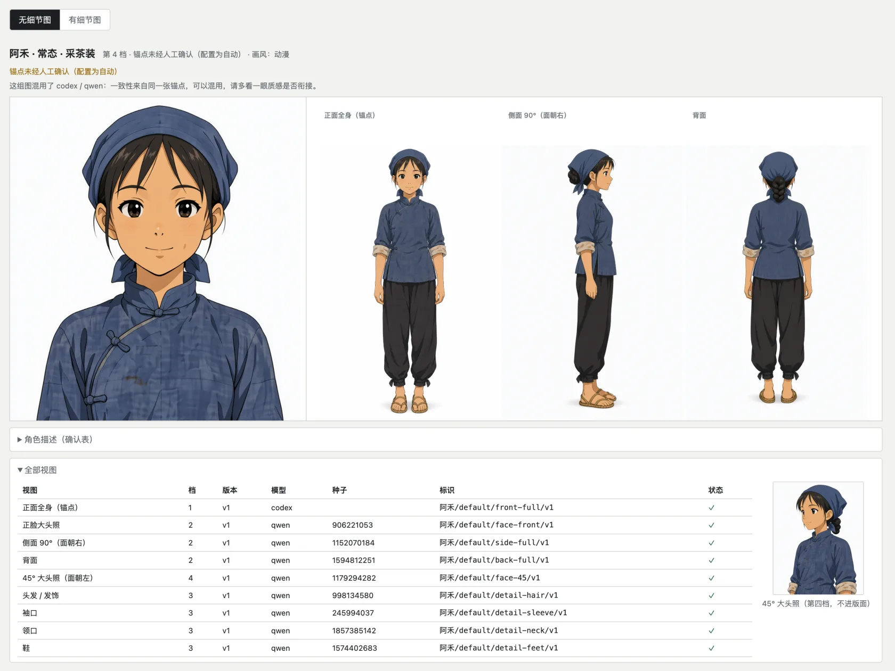

[](README.md)
[](README.en.md)
[](https://x.com/eternityspring)

# character-refs

給任何故事裡的角色**真出**參考圖——小說改編、自己原創的故事、單獨設計一個角色都行，不需要小說原文。一段話描述角色，出一組能直接掛進影片模型（H3 / Wan / Seedance）的參考圖。



**一組圖只有一個根**：正面全身錨點。只有它是文生圖，大頭照、側面、背面、細節圖都只參考這張錨點，
圖與圖之間不再互相參考——任何一張出壞了，單獨重出這一張，不牽連別的。

## 分檔，預設出到第二檔

| 檔位 | 內容 | 什麼時候出 |
| --- | --- | --- |
| 1 | 正面全身（錨點） | 總是，第一張 |
| 2（預設） | 正臉大頭照、90° 側面、背面 | 預設就出齊 |
| 3 | 細節圖：使用者點名的、角色最能認出來的地方；沒有就用預設的頭髮 / 髮飾、領口、袖口、鞋 | 有配飾或服裝局部的特寫 |
| 4（預設不出） | 45° 大頭照 | 明確要 |

依據是一次 H3 實測：只掛正面全身，服裝和背影都對，但臉會走樣；加一張大頭照，臉最接近。所以預設出齊第二檔，細節圖和 45° 按需再加。

## 一次性輸入

不用一項一項填。一段話：

> 阿禾，十六歲，1920 年代江南茶山上的採茶姑娘。個子小，常年在山上曬，臉是麥色的，眉眼彎彎，笑起來左邊有個酒窩……

agent 拆進身份、臉、頭髮、身形、皮膚、上裝、下裝、細節各欄位，缺的自己補，每項標來源（原話 / 推斷 / 預設），
列印確認表給你看。只有年齡、性別、年代推不出來才會問。

## 模型

四種，第一次使用時選，之後一直沿用：

| | 說明 |
| --- | --- |
| `qwen` | Qwen Image 2.1，走自己的 ComfyUI。每張 25–50 秒，尺寸精確，不吃訂閱額度 |
| `codex` | 本機 codex 內建生圖（GPT）。不要 API key，但吃 ChatGPT 訂閱額度（Plus 約 25 張觸頂） |
| `openai` | OpenAI Images API，預設 gpt-image-2，按量計費 |
| `custom:<名字>` | 自己的生圖命令，模板裡填 `{prompt_file}` `{refs}` `{out}` `{width}` `{height}` |

**主圖和派生圖可以使用不同模型，重出單張也能換。**一致性來自同一張錨點，不來自同一個模型——
Qwen 錨點 + GPT 派生、GPT 錨點 + Qwen 派生、同一組裡混用，實測都銜接得上。每張圖記錄自己的模型，混用只提醒。

## 畫風

內建兩個預設，名字中英文都認：

```bash
node scripts/character-refs.mjs new 阿禾-intake.json --out out/                 # 預設動漫；寫實用 --look 寫實
node scripts/character-refs.mjs looks                                            # 列出全部預設
```

| 預設 | 名字 | 實測 |
| --- | --- | --- |
| 動漫（預設） | `動漫` / `卡通` / `anime` | Qwen 四檔全部通過 |
| 寫實照片 | `寫實` / `realistic` | Qwen 與 GPT 多個角色 |

要自己的畫風：`look-template 動漫 > my-look.json`，改完 `--look my-look.json`。已有角色換畫風用 `restyle`，
換完全組標過期、從錨點重出。畫風和角色是分開的兩層，角色描述裡不許寫畫風詞——同一個阿禾，換個預設就是另一種畫法。

## 標識與重出

每張圖都有標識 `角色/造型/檢視/版本`（如 `阿禾/default/face-front/v2`），寫在檔名、`asset.json` 和 PNG 後設資料三處。

```bash
node scripts/character-refs.mjs gen 阿禾/asset.json detail-neck --model codex   # 單獨重出一張，存成新版本
```

重出不覆蓋舊版。凍結的只有三樣：錨點檔案、畫風快照、文字描述。任何一樣變了，依賴它的圖示成過期：
重出錨點 → 其餘全部過期；重出大頭照 → 掛了它的頭髮 / 領口細節過期；改了描述 → 全部過期。只標記，不刪除。

## 品質門

程式碼檢查，`check` 不過就 exit 1：

| 門 | 規則 |
| --- | --- |
| 尺寸 | 單邊 300–5760 畫素 |
| 寬高比 | 0.4–2.5 |
| 比例 | 跟檢視要求的一致（2:3 / 4:5 / 1:1） |
| 大小 | ≤ 20MB |
| 背景 | 全身圖查四邊夠白；大頭照只查上邊和兩側上半段；細節圖跳過並明說 |
| 過期 | 見上 |

前四道是 H3 / Wan / Seedance 參考圖要求的交集。**門查不了長相、角度和取景**，那幾項要自己看圖。

## 報告

`render` 出一張雙擊就能開的 HTML：一檔只有一張卡片；二檔起是設定圖版面（左大頭照，右上正面 / 側面 / 背面，右下細節條），
預設不顯示細節圖，頁面上一鍵切換。過期的圖示紅框，頁面頂部有圖例，滑鼠移上去能看到原因。介面內建中文、英文、日文（`render --lang en`），其他語言由 agent 現場翻一份文案；
角色描述保持原文，提示詞永遠英文。版面由程式碼排，不生成拼接大圖——拼接圖當參考圖，模型會把人畫小。

## 命令列直接使用

```bash
node scripts/character-refs.mjs config --model qwen --confirm-anchor yes --qwen-env-file ~/comfy.env
node scripts/character-refs.mjs intake-check examples/阿禾-intake.json
node scripts/character-refs.mjs new examples/阿禾-intake.json --out out/
node scripts/character-refs.mjs gen out/阿禾/asset.json          # 出錨點，停下等確認
node scripts/character-refs.mjs confirm out/阿禾/asset.json
node scripts/character-refs.mjs gen out/阿禾/asset.json          # 補齊第二檔：大頭照、側面、背面
node scripts/character-refs.mjs gen out/阿禾/asset.json --tier 3 --reason "E03 有髮飾特寫"
node scripts/character-refs.mjs check out/阿禾/asset.json
node scripts/character-refs.mjs render out/阿禾/asset.json --out out/character-refs.html
```

## 檔案

```
SKILL.md                    給 agent 讀的工作流
scripts/
  character-refs.mjs  config / intake-check / new / gen / confirm / check / render
  core.mjs                  檢視、提示詞、輸入校驗、版本與過期、檢查門
  models.mjs                四個生圖轉接器
  looks.mjs                 畫風預設表（寫實、動漫）
  i18n.mjs                  報告與確認表的介面文案（中英日）
  png.mjs                   PNG 讀寫與後設資料（零依賴）
  selftest.mjs              自測，不調模型
references/
  intake.md                 一段描述怎麼拆成欄位
  prompting.md              實測出來的提示詞寫法
  models.md                 四個模型的接法與實測
  schema.md                 asset.json 結構
examples/
  阿禾-描述.txt              一句話描述
  阿禾-intake.json           拆好的輸入
assets/
  report.webp               報告截圖（阿禾，錨點 GPT、其餘 Qwen）
```

## 自測

```bash
node scripts/selftest.mjs
```

234 項斷言，不調模型、不花額度，Qwen 和 GPT Image 使用本地假伺服器校驗請求格式，完整流程使用自定義命令造的白底圖跑通。

## 已知短板

- 實測過的畫風只有寫實和動漫；動漫版 45° 大頭照同樣轉不夠（Qwen 約 20–30°）
- 小疤痕容易畫成新傷；雙排扣這類大面積細節取景偏遠
- Qwen 的領口細節會把粗布畫得像絲絨，這一張換 codex 重出
- `openai` 只驗過請求格式，沒有使用真 key 跑過
- **只在 macOS + Node 24 上實測過**
