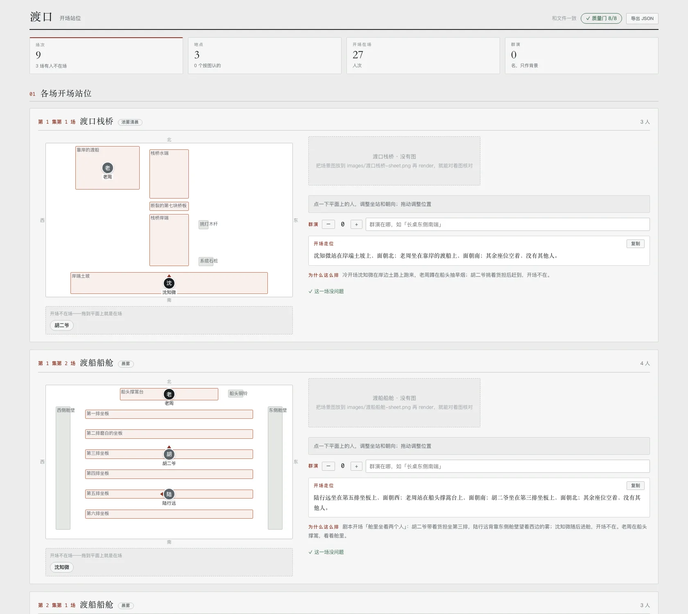

[](README.md)
[](README.en.md)
[](https://x.com/eternityspring)

# novel-staging

給 AI 短劇的每一場排**開場站位**：這一場一開始，每個出場的人在哪件東西旁、坐還是站、面朝哪。

**為什麼要單獨排**：短劇的每一段影片是一次獨立生成，各段自己決定誰坐哪。群戲裡六個人圍一張長桌，第一段桌邊多出五個沒名字的賓客，第三段端酒坐著的人穿著主角的衣服。分鏡的走位句一段接一段地交接，可每一場**第一段**的那一句是分鏡自己編的。所以在分鏡之前，每場先定一份站位，分鏡照抄。

- **先認圖** — 從場景圖的主視角裡認出人會站在旁邊、坐在上面的東西（4–20 件），推算到俯視平面上。站位只落在圖上真有的東西旁：提示詞裡寫了、圖上沒畫的高臺，人坐上去，每段影片都不一樣
- **再排站位** — 誰開場就在、誰後來才進；坐還是站跟著劇本；長輩坐主位、對立的兩方隔桌相對、被孤立的坐末位；劇本沒寫有別人就沒有群演
- **走位句由程式寫** — 「胡二爺坐在第三排坐板上，面朝北；其餘座位空著，沒有其他人。」分鏡這一場第一段照抄它
- **報告能調整** — 每場一張俯視平面，人可以拖動，點一下調整坐站和朝向，改完匯出就是新的 staging.json

**預設交付 `staging-report.html` HTML 工具報告**：雙擊開啟，拖動調整人物位置、坐站和朝向，在頁面內匯出修改後的 JSON。`staging.json` 同時作為工作資料儲存，Markdown 僅在需要文字版時透過 `--md` 匯出。報告介面預設中文；render 加 `--lang en` 輸出英文介面（走位句改用認圖時寫的英文名字）。



## 品質門：8 道，全是程式碼

| 門 | 規則 |
| --- | --- |
| 認了圖 | 每個地點 4–20 件東西 |
| 東西的寫法 | 名字不重複；平面位置是合法的框；按圖認的必須有圖上的框 |
| 地點有著落 | 每一場的地點都有認圖結果（給了 art.json 還核對地點編號） |
| 出場人物 | 每個人正好一條，不多不少；給了 script.json 還核對跟劇本一致，不給就**明說沒核對** |
| 在不在場 | 每個人都定了開場在不在，至少一個人在場 |
| **落在認出來的東西上** | 在場的人站的東西必須在認圖結果裡；只有能坐能站的東西才能寫「在它上面」；方位、坐站、朝向合法 |
| 不疊人 | 同一件東西同一側的兩個人沿這一側拉開 |
| 群演 | 人數是整數；有群演寫明在哪，沒有就不寫 |

自測裡每道門都有**擊穿用例**——證明它真的會攔。

## 報告：能拖動的俯視平面

- 按住一個人拖到平面上別處，鬆手時落在最近那件東西最近的一側；落在能坐的東西裡面就坐在它上面。換了一側，人自動轉過去面朝那件東西
- 平面下面是「開場不在場」的托盤：拖進平面就是在場，拖回托盤就是不在
- 點一下一個人，調整坐著／站著、八個方位的朝向
- 群演加減、寫在哪；開場走位句和這一場的檢查跟著實時更新
- 有場景圖時，滑鼠移到一件東西上，圖上它的框亮起來，對著圖核對
- 改動存在瀏覽器裡，重新整理不丟；「匯出 JSON」下載改過的 staging.json，餵回 `validate` 照樣能用

頁面上的演算法跟命令列是同一份：拖動落點、平面上的點、走位句、檢查規則都由 `stagingCore()` 算，整個嵌進頁面。

## 在管線裡的位置

```
novel-outline    → outline.json （人物名字）
novel-art        → art.json     （地點 + 場景圖）
novel-script     → script.json  （每一場誰出場、怎麼演）
novel-staging    → staging.json （每一場開場誰在哪）
novel-storyboard → storyboard.json
```

- `seed <script.json> --art <art.json> --outline <outline.json>` 確定性預填地點、場次、出場人物
- novel-storyboard 目前不自動讀 staging.json：`blocking` 命令打出每一場的開場走位句，寫進分鏡每場第一段的 `blocking`

## 命令列直接使用

```bash
node scripts/novel-staging.mjs seed script.json --art art.json --outline outline.json > staging.json
node scripts/novel-staging.mjs validate staging.json --script script.json --art art.json
node scripts/novel-staging.mjs checkup staging.json                 # 只跑品質門
node scripts/novel-staging.mjs render staging.json > staging-report.html  # 預設 HTML 工具報告
node scripts/novel-staging.mjs render staging.json --lang en > staging-report.html # 英文介面報告
node scripts/novel-staging.mjs render staging.json --md > staging.md # 按需匯出文字版
node scripts/novel-staging.mjs blocking staging.json                 # 每場的開場走位句
```

## 檔案

```
SKILL.md                 給 agent 讀的工作流
scripts/
  novel-staging.mjs      seed / validate / checkup / blocking / render / slug
  selftest.mjs           99 項斷言，不調模型
references/
  schema.md              staging.json 結構 + 座標系
  read-pass.md           怎麼從場景圖裡認東西（沒有圖時怎麼推算）
  staging-pass.md        怎麼排開場站位、怎麼按一句話調整
  report-style.md        報告和拖動畫布的設計約定
  test-fixtures/upstream/  上游樣例的複製，只給自測使用
examples/
  渡口-staging.json       《渡口》三個地點、九場的開場站位，全部品質門通過
assets/
  report.webp            報告截圖
```

## 自測

```bash
node scripts/selftest.mjs
```

99 項斷言，覆蓋平面幾何 / 拖動落點 / 走位句 / seed / 8 道門逐項擊穿 / 渲染（中英介面、轉義、嵌圖），還會單獨拿嵌進頁面的那份演算法的原始碼重建一份核對。不調模型、不花額度、1 秒跑完。改完腳本先跑這個。

**只在 macOS + Node 24 上實測過。** 程式碼沒有平臺相關呼叫，Linux 和更低版本 Node 理論上沒問題，但**沒驗過**。
